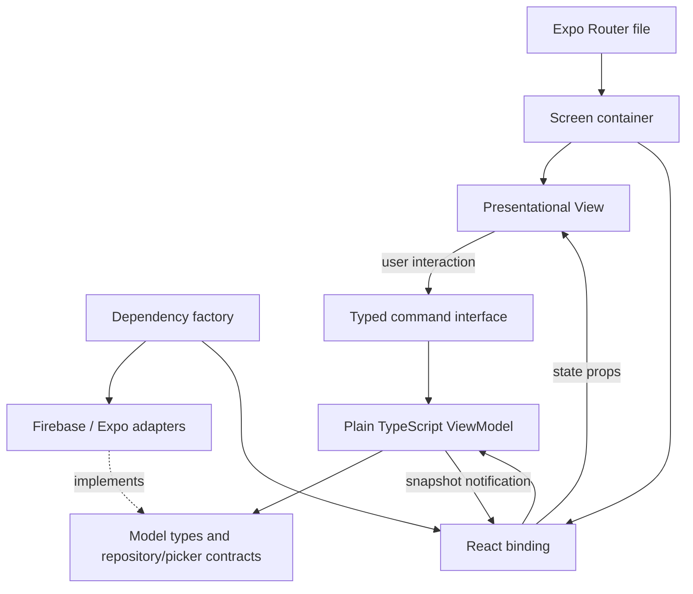

# Architecture

## Reading order

Start with `src/app/sign-in.tsx`, then follow `screens/AuthScreen.tsx` → `bindings/useAuthForm.ts` → `viewmodels/AuthFormViewModel.ts` → `models/auth.ts` → `data/FirebaseAuthRepository.ts`. This traces one interaction from the route to the backend contract without jumping between unrelated features.

For a visual change, start directly in `views/SignInView.tsx`, `SignUpView.tsx`, or `ResetPasswordView.tsx`. These files compose small components and contain no data fetching or account operations.

## Responsibilities

| Layer     | Owns                                                                               | Must not own                                         |
| --------- | ---------------------------------------------------------------------------------- | ---------------------------------------------------- |
| Model     | User/form/profile types, validation, backend and device contracts, domain failures | React hooks, Firebase types, navigation              |
| ViewModel | Immutable state snapshots, commands, busy/error/success state, async lifecycle     | JSX, React, router calls, concrete adapters          |
| View      | JSX, layout, text, inputs bound to snapshots, callbacks                            | Authentication calls, validation rules, Firebase SDK |
| Binding   | React subscriptions, typed command projection, ViewModel creation/disposal         | Backend selection, JSX screens, business rules       |
| Screen    | View selection, bindings, page animation, route callbacks                          | Validation or backend operations                     |
| Data      | Implements contracts, maps Firebase types/errors, uploads and persistence          | UI rendering, ViewModels, navigation                 |
| Bootstrap | Creates concrete dependencies and app-wide providers once                          | Per-screen state or business rules                   |
| Shared    | Generic UI, styling, motion, observable primitive                                  | Feature imports or Firebase setup                    |

MVVM does not require every UI detail to live in a ViewModel. Input focus and animation progress are ephemeral presentation details; keeping them in shared UI components avoids coupling domain code to a rendering framework.

## Dependencies and data flow

`ObservableViewModel` exposes stable `subscribe` and `getSnapshot` functions. Bindings use `useSyncExternalStore` to observe those snapshots. The form binding projects only the public command surface; views do not receive the ViewModel instance or its repository.

For frequently changing state, `useViewModelSelection` subscribes to only the fields a screen needs. Its framework-independent `selectSnapshot` helper preserves selection identity when unrelated fields change. Keep selectors and equality functions stable, and include every field the consumer reads. Chat lists use `useSharingGroups`; toolbar controls use `useMapControls`, so GPS fixes do not re-render those surfaces. Membership, error, and recording changes still propagate immediately.

Dependency direction is enforced by `eslint.config.js`, including restrictions for Models, ViewModels, Views, bindings, adapters, shared code, and route containers. Type-only imports of state/command contracts from ViewModels are allowed in Views.

## Composition and lifetime

`bootstrap/createAppDependencies.ts` is the only place choosing the Firebase repository, Expo picker, and city search adapter. It passes them into the framework-independent `bindings/dependencies.ts` factory. `AppProviders` keeps that dependency object stable, provides the dark navigation theme, and mounts `AuthProvider`.

- One `SessionViewModel` exists per provider and owns one active session subscription.
- Each auth route owns a fresh `AuthFormViewModel`.
- Leaving a route disposes its form, clears secrets/personal draft fields, and invalidates pending command results.
- The provider stops session listeners when it unmounts.
- Repository session observation is the source of truth for auth guards. Form commands never navigate.
- React Strict Mode may start/stop effects more than once; subscription setup and teardown remain paired.

Tests can call `createAuthDependencies({ repository: fakeRepository, avatarPicker: fakePicker, cities: fakeCities })` without loading React Native or Firebase. UI harnesses can inject the result through `<AppProviders dependencies={dependencies}>`.

## Why Firebase code has multiple files

`FirebaseAuthRepository.ts` stays small and implements the domain contract. Its helpers have distinct reasons to change:

- `firebase/registration.ts`: creates/authenticates the identity in the primary persisted session; never writes a profile.
- `firebase/profile.ts`: signed-in profile transaction; delegates optional avatar upload/cleanup through AvatarStorage.
- `firebase/sessionObserver.ts`: Auth/Firestore subscriptions, domain user mapping, stale-callback cleanup.
- `firebase/errorMapping.ts`: Firebase error codes translated to domain failures.
- `config/firebase/client.ts`: environment configuration and app initialization.
- `config/firebase/persistence.native.ts`: native AsyncStorage persistence. Metro selects it automatically; web uses `persistence.ts`.

Firebase `User`, `Auth`, Firestore snapshots, and Storage references never cross the repository contract. Do not store SDK objects in ViewModel snapshots.

## UI composition

Each auth page is an explicit View. `AuthFormLayout` supplies the common heading, feedback, submit button, and footer slot. `CredentialsFields` supplies shared credential inputs; `ProfileView` composes signed-in profile inputs and `AvatarField`. Authentication forms contain credentials only. There is no giant component switching the entire form based on page mode.

`shared/ui/styles.ts` defines common typography, layout, controls, and feedback styles. `views/styles.ts` contains only auth-specific arrangements. Colors live in `shared/theme/colors.ts`. Root CSS, app.json native backgrounds, the navigation theme, and `PageSurface` keep the underlying surface dark. If you change the background color, update the matching value in `global.css` and `app.json` too.

Reuse `SearchField` for search icons, focus styling, and keyboard-preserving clear actions; `SegmentedControl` for animated mutually exclusive tabs; and `ListEmptyState` for empty lists. `PrimaryButton` owns press feedback and reserves its label's dimensions while showing a loading indicator. Filtering stays in the feature layer, with deferred queries for responsive typing. Translation callbacks remain stable until the language changes, allowing translated lists to be memoized safely.

Settings uses a prominent profile disclosure and a `SettingsGroup` for related preference rows. `SettingsSection` owns only disclosure state, accessible expanded/disabled states, and reduced-motion-aware transitions; profile, sharing, language, and password commands remain in their existing feature bindings. `SettingsSignOut` keeps the session action separate and shows progress in a fixed icon slot without shifting its label. Expanded forms stay in the scrollable screen above the persistent toolbar.

Animation timings live in `shared/motion/tokens.ts`. Native routes use the native stack fade. Web uses a short exit/enter sequence. `PageSurface` stays opaque while only its content fades; reduced-motion settings disable page animation.

## Adding a field

1. Add its data shape to `models/auth.ts` and validation to `models/validation.ts`.
2. Add credential state to `AuthFormViewModel`, or profile state to `ProfileViewModel`, with a public command.
3. Expose the command in `bindings/useAuthForm.ts` or `bindings/useProfile.ts`.
4. Add its input to the appropriate View component, usually `ProfileView` for profile data.
5. Extend `firebase/profile.ts`, `sessionObserver.ts`, and the security rules if it is persisted.
6. Update model/ViewModel/repository tests, then run `npm run check` and export the app.

To change only a label or placement, edit the View component and skip the other layers.

## Adding another feature

Use the same `features/<feature>/models`, `data`, `viewmodels`, `bindings`, `screens`, and `views` structure only where needed. A simple static page does not need a repository or ViewModel. Add thin route files in `src/app`, register dependencies in bootstrap, and reuse shared controls. Keep feature-specific UI out of `shared` until there is a real shared responsibility.

## Verification limits

Model and ViewModel tests use fake contracts. Repository tests replace Firebase SDK modules during synchronous adapter loading, restore the loader immediately, and assert behavior against mocks. These checks prove orchestration, validation, state isolation, subscription cleanup, and error handling; they do not validate deployed rules or a live Firebase project. Device testing is still needed for native permissions, persistence, keyboard behavior, and transition timing.

## Migration from the previous layout

| Previous location                              | Current location                                                    |
| ---------------------------------------------- | ------------------------------------------------------------------- |
| `src/composition/AuthProvider.tsx`             | `bootstrap/createAppDependencies.ts` plus `features/auth/bindings/` |
| `src/core/ObservableViewModel.ts`              | `shared/mvvm/ObservableViewModel.ts`                                |
| `src/firebase.ts` and `src/persistence*`       | `config/firebase/`                                                  |
| `src/theme/`                                   | `shared/theme/`                                                     |
| `views/AuthFormView.tsx`                       | Separate page Views and `views/components/`                         |
| `views/AuthScaffold.tsx`                       | `shared/ui/ScreenLayout.tsx`, `PrimaryButton.tsx`, `Feedback.tsx`   |
| `views/AuthTextInput.tsx`                      | `shared/ui/TextField.tsx`                                           |
| `views/usePageTransition.ts` and related files | `shared/motion/`                                                    |

Paths in this table are relative to `src` unless prefixed with `src/`. The legacy `App.tsx` and `index.ts` wrappers were removed; `package.json` points directly to `expo-router/entry`. The real startup layout is `src/app/_layout.tsx`. Restart Metro after the move so it does not retain stale module paths.

## Calendar fields

`views/components/BirthdayField.tsx` supplies feature-specific date bounds and sends selected values to the existing `setBirthday` command. `shared/ui/DateField.tsx` renders the Android calendar dialog or an iOS calendar modal; Metro selects `DateField.web.tsx` for the browser's date input. The web field opens the picker on focus/click where browser user-activation policy permits it, and its standard calendar icon remains available as a fallback. The picker is presentation state; the ViewModel still owns the birthday value and validation.

Dates use the local date-only helpers in `shared/utils/dateOnly.ts`, avoiding UTC conversion that could shift a birthday by one day. The calendar restricts selection from 1900 through today. Custom native development builds must be rebuilt once after adding the date-picker dependency; a compatible Expo Go app already includes it.

The dependency factory injects registration lifecycle callbacks into AuthFormViewModel. Before contacting Firebase, SessionViewModel marks a one-time Profile landing intent. HomeScreen redirects to /profile before rendering Home when that intent exists; ProfileScreen acknowledges it. This handles SDK auth events arriving before or after the registration promise without flashing Home or Sign in. Registration failure clears the intent. ProfileViewModel signals saveComplete only after a successful save (or a valid unchanged profile); ProfileScreen then transitions to /. No credentials or registration flags are placed in route parameters.

Feedback uses an opacity-only animation and retains its most recent text/height after dismissal. A minimum 80-point slot keeps short alerts from changing the form height; longer messages preserve their measured space once hidden. Do not conditionally unmount `Feedback` or use `display: none`, because the centered form would shift. Fade timings are in `shared/motion/tokens.ts`. Hidden feedback is excluded from accessibility and hit testing. Browser measurements confirmed unchanged heading, input, and submit-button positions before, during, and after the timed registration notice.

## Signed-in profile and city search

ProfileScreen mounts a profile editor keyed by user ID; HomeScreen renders the interactive OpenStreetMap map. Its binding owns ProfileViewModel, projects only public commands, and hydrates live profile updates only while the draft is clean. Account switches unmount the previous editor. ProfileViewModel owns validation, picker/save loading, debounce, abort, and stale-result guards. CityRepository is a model contract; OpenMeteoCityRepository parses the external API and bootstrap selects it. Tests inject a fake city service. Sign-up never uploads photos or depends on profile storage.

## Responsiveness

Motion tokens use a 150 ms web entrance, 50 ms web exit, 160 ms native transition, 70 ms button press, and 100/130 ms feedback fades. Feedback still reserves its layout space; the old registration notice has been removed because registration proceeds directly to Profile. City searches debounce for 150 ms and cache at most 32 normalized queries for five minutes with least-recently-used eviction. Failed requests are not cached and stale-response guards remain active. Clean profile drafts skip save requests. Native Google login configures the SDK once per client configuration and does not sign out the SDK before each sign-in. Network services and OS account/picker dialogs still determine their own response times.

## Avatar storage provider

AvatarStorage is an SDK-free contract in models/avatarStorage.ts. CloudinaryAvatarStorage implements unsigned HTTPS upload and short-lived deletion-token cleanup. Bootstrap supplies it to FirebaseAuthRepository, whose profile helper persists only the URL, preserves creation time, checks the current Firebase user, and attempts cleanup when the profile write fails. Cloudinary public config lives in config/cloudinary.ts. The ViewModel and View do not know the storage provider. No API secret or deletion token is stored in profile state/Firestore. See CLOUDINARY_SETUP.md for public preset limitations and the production signing boundary. Legacy Firebase Storage rules are retained only for old uploads and are not deployed by firebase.json.

## Session restoration and protected pages

The root layout anchors at index. AuthNavigator shows SessionLoadingView until Firebase resolves its first persisted auth result, then exposes either the signed-out routes or index/profile. HomeView contains the interactive OpenStreetMap map and Map/Contacts tabs. AuthenticatedShell keeps AppToolbar outside the transitioning stack on every signed-in route, with Sign out in its center menu; profile.tsx delegates to ProfileScreen. The profile back button falls back to /. Auth initialization explicitly selects platform persistence and caches the default instance, including Fast Refresh reuse. Native uses Firebase getReactNativePersistence(AsyncStorage); web uses IndexedDB/local-storage persistence with popup support. observeFirebaseSession listens to ID-token changes but keeps one profile listener while the UID remains the same. Tokens remain managed by the Firebase SDK and never enter route parameters, ViewModel snapshots, or a separate app-managed token cache.

Normal sign-in and cold-start restoration do not set the registration landing intent; complete profiles go Home after profile resolution. The intent is memory-only: a later app launch restores the Firebase session and opens Home. Profile save errors never set saveComplete and do not navigate away.

## Incomplete-profile routing

AuthUser carries profileStatus (loading/ready/error). The Firebase adapter emits loading while fetching the document, ready after a usable snapshot, and error on a failed or timed-out read; a missing cache entry is not treated as a confirmed missing document. SessionViewModel derives profileRequired only from a ready profile using the shared profile validator (name, birthday, location; avatar optional). HomeScreen waits during lookup and redirects incomplete users to Profile. ProfileViewModel calls the injected onSaved callback after a successful backend write; SessionViewModel updates the same user's profile fields and clears profileRequired before ProfileScreen navigates Home. Failed saves never clear the requirement.

## Home presentation shell

HomeView owns transient dropdown visibility. HomeDropdown animates opacity and translation without changing page layout, and respects reduced motion. Contacts shows saved names, an empty state, and Add new contact. The name form validates and saves through ContactsViewModel. Map and outside taps close the dropdown. AppToolbar reserves five positions from the wireframe: Home, an inactive placeholder, the center Sign out menu, another inactive placeholder, and Settings. AuthenticatedShell owns route navigation and menu visibility. Home returns to / and Settings opens /profile?edit=1; the toolbar stays mounted while screens transition and profile content scrolls above it. Signed-out screens do not show the toolbar. Contact storage uses a Firestore subcollection for the signed-in user; the map feature provides an interactive OpenStreetMap embed.

## Profile settings and password changes

Full name, birthday, and a selected location are required for profile completion. Phone number and avatar are optional. `ProfileViewModel` validates and normalizes an entered phone number, and exposes `setPhoneNumber` through the profile binding. Blank phone input can be skipped during onboarding; an explicit edit to blank removes a previously saved number. The repository saves phone edits in the same transaction as the profile, under `users/{uid}/private/phone`, with owner-only rules. It never adds phone data to the contact-readable profile, discovery records, or map markers. The session observes this optional document independently without delaying Home; phone edits are tracked separately so a late read cannot overwrite typing, and saving other fields cannot erase an unread number. The display cache does not persist phone numbers.

The far-right toolbar settings button opens /profile?edit=1 through AuthenticatedShell. Settings reuses the profile editor and adds PasswordEditor, backed by an independent PasswordViewModel and an injected repository command. The Firebase adapter derives hasPassword from providerData, reauthenticates email/password users with their current password, checks that the same account is still active, then updates the password through Firebase Auth. Passwords never enter Firestore, route parameters, or persistent storage. The password form prevents duplicate submissions, clears secrets on success/disposal, and ignores late UI results after unmount. Google-only accounts display a Google Account password-management note; account setup does not show the password editor. Profile saving and password updating use separate buttons and block concurrent edits.

Toolbar motion animates visual surfaces inside fixed touch targets: press scale uses a damped spring, opacity eases on release, and active indicators fade. The center glyph transitions between menu and close using transforms. Dropdowns animate opacity, scale, and translation without reflow. Native animations use the native driver, interrupted animations stop before retargeting, and reduced-motion preferences apply immediately. Tapping Home while already there avoids replacing the screen.

## Contacts

The contacts feature has its own model contract, Firebase adapter, plain TypeScript ViewModel, React binding, and presentation. Bootstrap injects FirebaseContactRepository. Contacts are stored at users/{uid}/contacts/{contactId} as name and server-generated createdAt. Rules allow only the authenticated owner to read and create these documents; contact update/delete are not exposed. Names are trimmed and limited to 100 characters. The live listener sorts names alphabetically; pending writes do not appear as confirmed saves. Saving blocks duplicate taps and returns to the list only after backend acknowledgement. Failed saves preserve the draft. User-keyed screen bindings release listeners and ignore late results after account changes or navigation. Publish firestore.rules before using the feature against Firebase; local checks do not deploy rules.

## Fast profile restoration and launch branding

Bootstrap injects StoredProfileCache with AsyncStorage through the ProfileCache model contract. Only complete profile display fields are cached under a versioned UID key with a seven-day TTL; credentials and tokens are never cached here. The Firebase observer races cache hydration against the live snapshot with account/version guards: cached display data cannot replace a newer snapshot or cross an account change. Confirmed incomplete profiles invalidate the cache. A valid cached profile remains usable after a background read failure. Uncached failures expose Retry and never mount an empty Settings editor. Profile registration remains independent of a first profile read.

Native splash lifecycle is configured in bootstrap/splash.ts and released as soon as the React navigator mounts so authentication/network delays cannot trap the user behind the native splash. Launch screen configuration is in app.json. Toolbar glyphs share the accent color; the active page uses an indicator instead of different icon colors. Navigation has no artificial exit delay, while native transitions and menu animations remain short and respect reduced motion.

## Map rendering

MapViewModel owns saved-city resolution, stale-result/abort guards, persisted map language, and user-facing lookup state. Bootstrap injects the existing CityRepository and StoredMapPreferences backed by AsyncStorage. The city adapter now retains validated coordinates, but the saved profile schema stays unchanged. An exact normalized city/state/country label match is required; ambiguous/missing matches never generate a marker.

MapCanvas renders a shared MapLibre HTML document using OpenFreeMap vector tiles based on OpenStreetMap. Native uses react-native-webview; web uses a sandboxed iframe. MapViewModel consumes only the device location tracker; profile city geocoding is independent of the map. Native overlays provide large zoom/recenter controls, the language selector, and a GPS coordinate/accuracy badge. Memoized views and stable commands isolate the map from contact updates.

Only the saved city is sent to the existing geocoder. A deduplicated message bridge passes map state and camera commands. Profile labels use textContent rather than HTML interpolation. A Content Security Policy restricts map resources; native navigation allows only map attribution links. No Google Maps API key or billing configuration is used. See MAP_SETUP.md.

AppToolbar uses a persistent rounded dock, matching icon colors, an animated active highlight, and a raised outlined center menu. TOOLBAR_CONTENT_HEIGHT keeps the account-menu offset aligned with the dock. Duplicate Settings navigation is ignored to preserve profile drafts. No toolbar actions were added to the two unassigned placeholders.

### Device travel tracking

ExpoLocationTracker implements the LocationTracker model contract and is selected in bootstrap. MapViewModel owns watcher lifetime and foreground/manual pause state. TravelRecorder validates fixes, filters jitter, bounds memory, and splits gaps. useMap binds AppState to the ViewModel and cleans up the watcher on unmount. The map bridge sends live GPS and segmented history; the document updates a single GeoJSON MultiLineString source and a separate GPS marker, preserving camera gestures. GPS following pauses on manual pan and resumes on recenter; profile data never enters the map bridge. Track data stays in the current map session; no backend writes or routing service are involved.

## Contact requests and nearby presence

ContactsProvider owns one ContactsViewModel per authenticated UID outside the route stack. It maintains contact and request listeners across signed-in screens and hosts ContactNotificationHost. useContacts supplies Map-screen GPS/foreground state without owning the provider lifetime. ContactEditorViewModel owns the protected contact/[id] editor and writes only a private nickname or mutual removal. FirebaseContactRepository implements registration, directory lookup, transactions, read-only profile hydration, and bounded geohash subscriptions. The Map bridge receives only public marker data and an explicit focus revision, preserving GPS follow and travelled-path rendering. Security rules enforce sender identity, recipient-only atomic acceptance, mutual profile consent, nickname-only updates, and short location leases. See SOCIAL_SETUP.md for schema, deployment, quotas, and tests.

## Person-to-chat navigation

Map user cards and contact chat buttons pass the person's UID to `openPersonChat`. The chat workspace waits for contact, membership, inbox, and relevant private-member activity snapshots before `personConversation` selects an accessible transcript: unread messages first, then the latest activity. The resolved selection stays fixed while reading, so live receipts or list reordering cannot switch conversations. Explicit group-room and member links keep their specified targets. History remains filtered by `DeviceChatRepository`, including messages deleted only on this device; navigation never copies or rewrites Firebase messages.

## Social list presentation

`useConversationRead` registers only the focused transcript while the app is in the foreground. `UnreadChatsViewModel` excludes that transcript from shared badge counts, including the toolbar and sender icons, so messages arriving before the transcript snapshot do not flash an unread badge. Message visibility still drives read receipts; the chat list, hidden routes, and background app never mark messages read. A local read cursor advances immediately and takes precedence over delayed server receipts. Queries restart from that cursor and discard stale callbacks, preserving newer unread messages after leaving. Failed or in-flight receipt writes survive Retry; view registrations have independent cleanup tokens and are cleared at session teardown.

Contacts and Private groups keep creation beside the search/list controls using the shared `CollectionToolbar`. Full contact rows have distinct map, edit, and chat targets; the compact map dropdown retains its own Show all/New contact actions. `InlineRetry` associates a recoverable load failure with its list. Group metadata and membership remain live, while expansion and search are presentation state.

The chat list offers All chats, Unread, and Private groups filters. `filterConversations` preserves canonical transcript identities and retains a group with unread private-member threads even when the group room itself is read. Filtering never changes the active conversation. The group disclosure button is a sibling of the conversation button, so expanding members cannot accidentally open the room. Lists remain virtualized; search is deferred and existing reduced-motion-aware transitions remain in use.

`SharingViewModel` tracks membership and directory load failures separately from GPS/preferences/action failures. Each successful subscription clears only its own load failure. `useSharingGroups` exposes membership errors to Chats, so location publication failures cannot mark a healthy chat list as broken. Location failures continue to be reported in the sharing experience. Tests exercise independent recovery, stale subscription guards, and unread group-member filtering.

## Responsive live updates

`ContactsProvider` exposes stable commands and its ViewModel. Screens subscribe through `useContactsSelection` to the directory, list, or overlay fields they render; GPS positions, map focus, and request-form keystrokes no longer invalidate unrelated lists. The contact editor reads the shared model directly and retains its existing live detail observer. These presentation selectors do not throttle network subscriptions or unread updates.

`createConversationProjection` retains unchanged row identities across message, membership, and unread snapshots, allowing memoized conversation rows to skip work. It retains only the current workspace projection and resets across account changes; transcript selection still uses canonical contact/group keys. Stable row actions preserve expansion during live reordering.

The map stays mounted during navigation, but the native/Web bridge skips state packets while its screen is hidden and sends the latest positions, markers, and trails when it returns. The shared GPS recorder and location-sharing ViewModels continue their normal foreground lifecycle. Reply/edit focuses the composer on the next frame instead of waiting for the removed message-action modal. All existing reduced-motion preferences remain respected.
